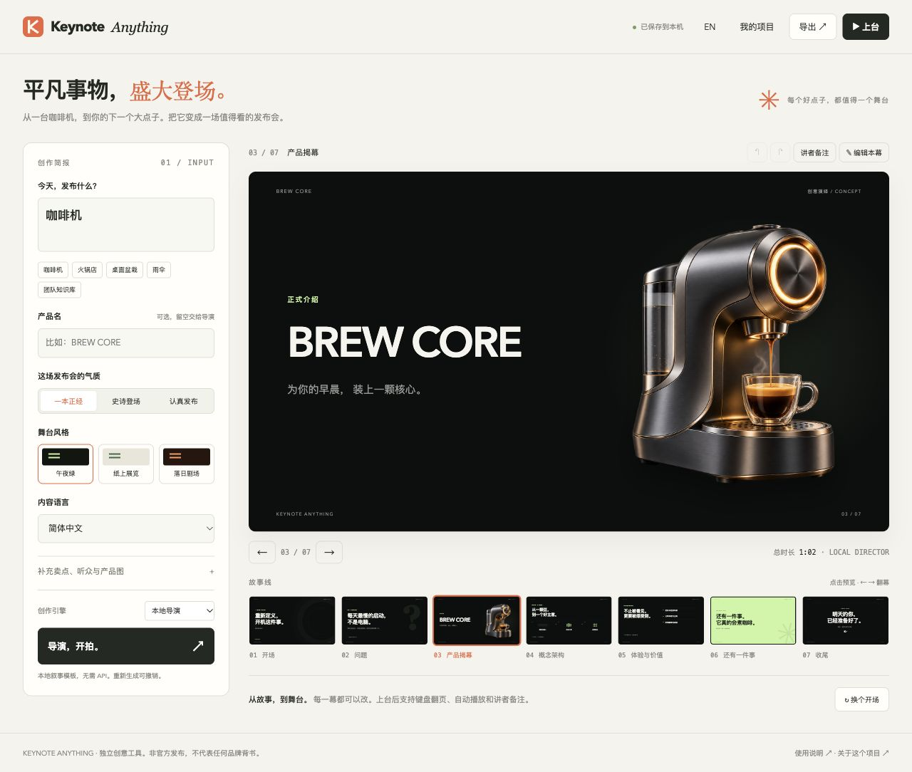

# 万物发布会

**把普通东西，发布得不普通。**

输入咖啡机、火锅店、桌面盆栽，或者你的新产品，让它拥有一场完整的七幕发布会。

[在线体验](https://dingyucanada.github.io/keynote-anything/) · [使用说明](GUIDE.md) · [配置 AI](AI.md)



## 上手只需三步

1. 输入「今天发布什么」，选一本正经、史诗登场或认真发布。
2. 点击「导演，开拍」，逐幕调整标题、卖点和产品图。
3. 点击「上台」，或者导出独立 HTML、分享海报、讲稿和项目文件。

开场 → 问题 → 产品揭幕 → 概念架构 → 体验价值 → 还有一件事 → 收尾。

本地导演无需 API 和登录，使用五组精心编排的主题模板与通用模板。它并不假装是大模型。需要针对任意产品深入创作时，可连接自己的兼容 API，由 AI 导演生成文案，再由你编辑定稿。

## 能做什么

- 三种语气、三种舞台主题、中英文双语。
- 每幕实时编辑；复制、前后移动、删除；撤销和重做。
- 自动保存当前项目，保留最近四次生成前的快照。
- 上传产品图，本地压缩，导出时内嵌。
- 按键翻幕、自动播放、讲者备注、全屏展示。
- 导出单文件 HTML，离线可播；导出竖版 PNG 海报、Markdown 讲稿和可重新导入的 JSON。

## 本地运行

安装 Node.js 20.6 或以上版本，在项目目录运行：

```sh
npm start
```

浏览器打开 `http://127.0.0.1:4317`。无需安装依赖。

## 适合的场景

团队破冰、开发者活动开场、产品叙事排练、培训中的表达练习，以及把日常小物认真发布一次。

这是一款独立创意工具。生成的是网页发布会，不是 PowerPoint 或视频；AI 文案需要人工核验，浏览器存储也不能代替文件备份。项目未包含任何公司官方演讲原稿或私有资料。
